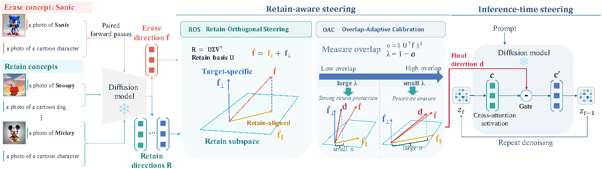

# RASteer

**Retain-Aware Activation Steering for Concept Erasure in Diffusion Models**

Yongliang Wu, Haori Lu, Yulun Wu, Jinqi Luo, Xingyu Zhu, Yaoyao Liu

[Project page](https://rasteer.cvmlgroup.web.illinois.edu/)



RASteer removes unwanted concepts from diffusion models through activation steering, without training or changing model weights. Built on cross-attention output steering (CASteer), it:

- builds a subspace from the concepts to preserve and removes their shared components from the erasure direction, separately for every layer and denoising step;
- adaptively calibrates this removal per layer from the overlap between the erasure direction and the retain subspace, so no extra hyperparameter is tuned.

On unsafe content, instances, and artistic styles across SD v1.4, v1.5, v2.1, and SDXL, RASteer improves concept preservation while keeping erasure effective. On I2P, it reduces exposed body-part detections from 612 to 13.

## Repository layout

```
core/
  construct_prompts.py   paired prompts that differ only by the target concept
  vector_dump.py         collects token-averaged cross-attention outputs
  controller.py          steering controller: retain-orthogonal direction + clipped steering
  diffusion_steering.py  forward hooks on every U-Net cross-attention output
  utils.py               pipeline loading (sd14, sd15, sd21, sdxl)
scripts/
  estimate_steering_vectors.py  per-layer, per-step steering vectors for one concept
  run_with_steering.py          generation with erasure (CLIP templates or COCO captions)
  run_i2p_eval.py               generation on the 4,703 I2P prompts
eval/                    NudeNet counting, COCO-3k metrics, instance/style metrics
examples/                end-to-end protocols for the paper's tables
data/                    ImageNet class names, CLIP templates, COCO-30k captions
```

## Setup

```bash
conda create -n rasteer -y python=3.10
conda activate rasteer
pip install -r requirements.txt
export PYTHONPATH=$PWD
```

Model weights are downloaded from Hugging Face into `./cache`.

## Quick start

**1. Estimate steering vectors** for the concept to erase and for each concept to retain. `--mode` is `concrete` (objects, characters), `style` (artistic styles), or `human-related` (unsafe content).

```bash
python scripts/estimate_steering_vectors.py --model_name sd14 --concept "Snoopy" \
    --mode concrete --save_name snoopy --output_dir vectors/sd14
python scripts/estimate_steering_vectors.py --model_name sd14 --concept "Mickey Mouse" \
    --mode concrete --save_name mickey --output_dir vectors/sd14
```

**2. Generate with erasure.** Pass the retain vectors to enable retain-aware steering; omit `--retain_concept_path` and `--use_all_diffusion_steps` for the CASteer baseline.

```bash
python scripts/run_with_steering.py --model_name sd14 --generate_concept "Mickey Mouse" \
    --num_images_per_prompt 3 --batch_size 3 --seed 42 --output_dir results/demo \
    --steering_strength 2.0 --intermediate_clipping --use_all_diffusion_steps \
    erase --concept_path vectors/sd14/snoopy.pt \
    --retain_concept_path vectors/sd14/mickey.pt --retain_mode auto_layer
```

Multiple paths can be passed comma-separated to `--concept_path` (multi-concept erasure) and `--retain_concept_path`.

## Reproducing the paper

| Experiment | Script |
|------------|--------|
| Unsafe-content erasure on I2P, general-content preservation on COCO-3k (SD v1.4) | `bash examples/i2p_coco_protocol.sh` |
| Instance and style erasure (`sd14`, `sd15`, `sd21`, `sdxl`) | `bash examples/table3_protocol.sh sd14` |

The I2P protocol counts exposed body parts with the NudeNet detector shipped in the public [RECE](https://github.com/CharlesGong12/RECE) repository; set `RECE_METRICS` to its `utils/metrics` directory. The COCO evaluation expects real COCO images under `cache/coco_real/` and downloads any that are missing.

## Hyperparameters

| Parameter | Value | Flag |
|-----------|-------|------|
| Steering strength β | 2.0 (SD v1.x), 3.0 (SD v2.1, SDXL) | `--steering_strength` |
| Clipped steering, max(β⟨d, c⟩, 0) | on | `--intermediate_clipping` |
| Per-step steering vectors | on | `--use_all_diffusion_steps` |
| Retain calibration | overlap-adaptive | `--retain_mode auto_layer` |
| Prompt pairs per concept (concrete / style) | 50 | `--num_prompts` |
| Denoising steps | 50 (SD v1.x, v2.1), 30 (SDXL) | — |

## Acknowledgements

This code builds on [CASteer](https://github.com/Atmyre/CASteer). The NudeNet evaluation follows [RECE](https://github.com/CharlesGong12/RECE).
